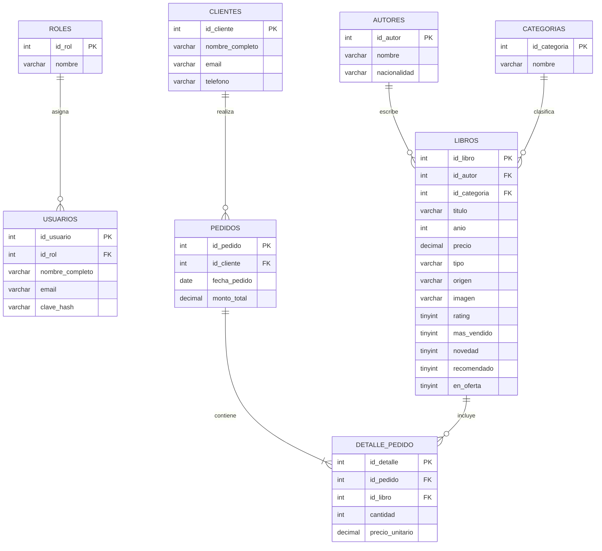

# Modelo entidad-relación

Ocho entidades. El pedido junta un cliente con uno o varios libros. Autor y categoría clasifican títulos. Un libro se vende muchas veces: no es una unidad única. El rol clasifica a quien inicia sesión.

No hay editorial. La landing no muestra ni filtra por editorial: el título se entiende con autor y categoría. Agregarla ahora sería una tabla que ninguna pantalla lee.

`USUARIOS` no es lo mismo que `CLIENTES`. El usuario entra al sitio. El cliente es quien figura en una venta. Una venta puede existir sin cuenta, y una cuenta puede existir sin compras.

## Cardinalidades

| Relación | Lectura |
| --- | --- |
| Rol → usuario | Un rol tiene cero o muchos usuarios. Cada usuario tiene un solo rol. |
| Autor → libro | Un autor tiene cero o muchos libros. Cada libro tiene un autor. Onetti está cargado con cero. |
| Categoría → libro | Una categoría tiene cero o muchos libros. Cada libro tiene una categoría. |
| Cliente → pedido | Un cliente puede no haber comprado o haber comprado varios. Cada pedido es de un cliente. |
| Pedido → detalle | Un pedido tiene uno o muchos renglones. Cada renglón pertenece a un solo pedido. |
| Libro → detalle | Un libro puede no haberse vendido o aparecer en muchos pedidos. Cada renglón es de un solo libro. |

Pedido y libro son muchos a muchos. `DETALLE_PEDIDO` es la entidad intermedia: existe porque hay que guardar `cantidad` y `precio_unitario`, que no son de ninguna de las dos puntas solas.

## Atributos opcionales

Pueden quedar vacíos: `nacionalidad`, `anio`, `precio`, `imagen`, `telefono`. En el script, los que usamos en `NULL` a propósito son `nacionalidad` (Quino), `anio` y `precio` (Mafalda) y `telefono` (Ana y Pedro).

`email` es único. Dentro de un mismo pedido, `id_libro` no se repite.
